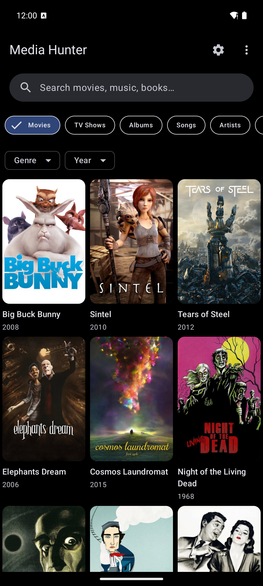
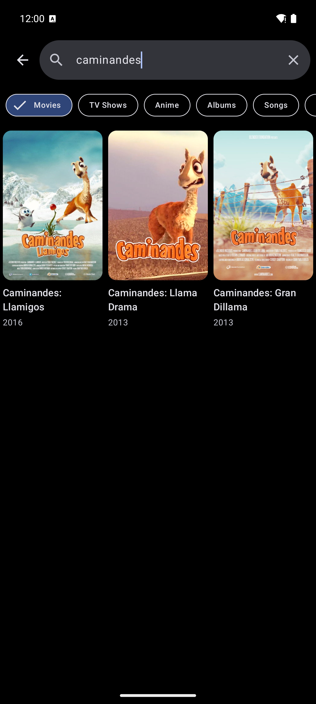
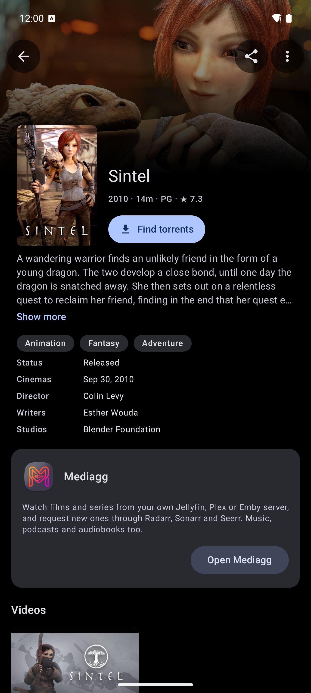
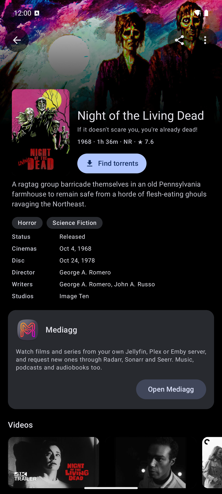
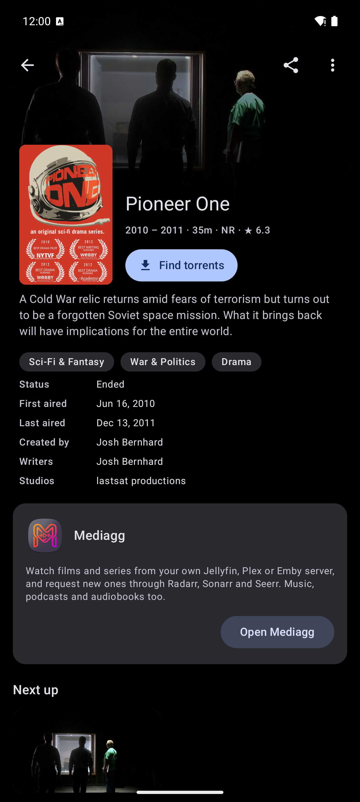
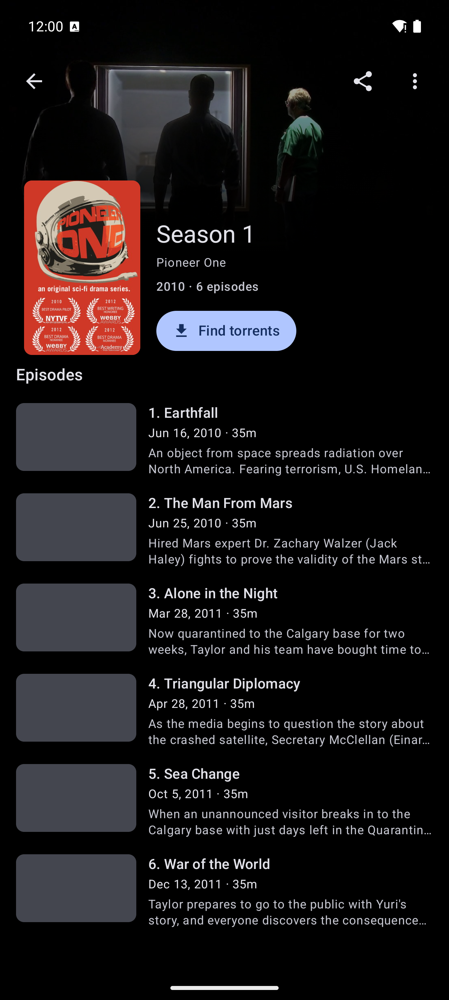

# Media Hunter

Browse movies, TV shows, anime, music, books and games, then find torrents for exactly the title you picked, all in one Android app.

Media Hunter pulls catalogues from TMDB, AniList, Deezer, Open Library and RAWG. It embeds [TorrentSearch](https://github.com/c4Entertainment/TorrentSearch) to search dozens of torrent sites at once. Searches started from a title carry its IMDb or Kitsu ID, year, season and episode, so you get that release rather than every torrent with a similar name.

## Screenshots

<p>
  
  
  
</p>
<p>
  
  
  
</p>

The screenshots show films and series that are free to share: Blender's open movies, public-domain classics and Pioneer One.

## Download

[](https://f-droid.org/packages/com.c4entertainment.mediahunter/)

Media Hunter is on its way to F-Droid; the link works once it's accepted. APKs are also on the [Releases](https://github.com/c4Entertainment/MediaHunter/releases) page.

## Features

### Browse
- **Movies and TV:** trending titles and search from TMDB, in a grid or list, with details, cast and trailers.
- **Anime:** trending and search from AniList.
- **Albums and Songs:** Deezer charts and search.
- **Books:** trending today on Open Library.
- **Games:** popular this year on RAWG.
- Offline cache for movie and TV listings.
- **Releases:** a week-by-week calendar of US digital, disc and cinema releases, most popular first, with each film's dates on its details page.
- **Status at a glance:** cards show where each title stands: "In cinemas", "Digital 17 Nov", "On disc", "New ep 18 Nov", "Ended".
- **One search screen** for every section, with recent searches.

### Find torrents
- A **Find torrents** button on every movie and show.
- TV shows offer the **latest episode**, any season, any episode, or the whole series. Anime offers the whole series or any episode.
- **Exact matching:** release names are parsed for title, year, season and episode, the way Radarr and Sonarr do it. Other titles, years and episodes are hidden, so "The Matrix" never returns *Matrix Reloaded*.
- **ID lookups:** YTS, ThePirateBay and EZTV look titles up by IMDb ID.
- **Torrentio:** built in and on by default. It searches many sites by IMDb or Kitsu ID, down to the episode.
- Everything else from TorrentSearch: 40+ providers, Torznab support, bookmarks, search history and filters.

## Building

```sh
git clone --recurse-submodules https://github.com/c4Entertainment/MediaHunter.git
```

If you already cloned without submodules, run `git submodule update --init`. TorrentSearch lives in `external/TorrentSearch`, on the `media-hunter` branch of the fork, and is built from source as a composite build.

Add your keys to `local.properties` in the project root:

```properties
# Required: https://www.themoviedb.org/settings/api
TMDB_API_KEY=your_tmdb_key

# Optional: enables the Games section. Free at https://rawg.io/apidocs
RAWG_API_KEY=your_rawg_key
```

AniList, Deezer, Open Library and Kitsu need no keys. Keys can also be passed as Gradle properties (`-PTMDB_API_KEY=…`) or environment variables, and people can enter their own TMDB and RAWG keys in the app under Settings → API keys.

To sign local release builds with the debug key, add `signReleaseWithDebugKey=true` to `local.properties`; without it, release builds are unsigned (F-Droid signs its own).

Open the project in Android Studio and run the `app` configuration, or use the command line:

```sh
./gradlew :app:installDebug
```

Requirements: JDK 17 or newer. The project uses compileSdk 37 and minSdk 25.

## Tech

- Kotlin, Jetpack Compose and Material 3
- Clean architecture, Hilt, Room, Paging 3 and DataStore
- Retrofit and Moshi (TMDB, Deezer, Open Library, RAWG, Kitsu), plus AniList GraphQL
- TorrentSearch, embedded as a library: Ktor, Koin and Jsoup

## License

Media Hunter is free software under the GNU General Public License v3.0 or later (SPDX: `GPL-3.0-or-later`); see `LICENSE`. TorrentSearch, which it includes, is MIT-licensed; see `external/TorrentSearch/LICENSE`.
